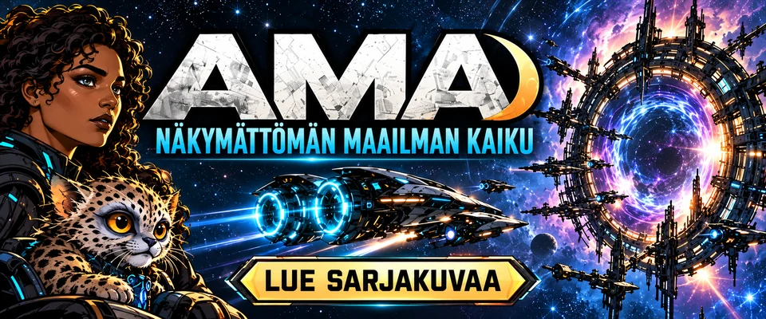

# AMA – Näkymättömän maailman kaiku

Suomenkielinen avaruusmysteeri sarjakuvana. MasterJ:n AMA-lukusivu.

**[Avaa sarjakuva →](https://jakke77.github.io/ama-sarjakuva/)**

## Jaksot

| Jakso | Nimi |
| --- | --- |
| 1 | [Saapuminen](https://jakke77.github.io/ama-sarjakuva/#lue-1) |
| 2 | [Salamatkustaja](https://jakke77.github.io/ama-sarjakuva/#lue-2) |
| 3 | [Portin toisella puolella](https://jakke77.github.io/ama-sarjakuva/#lue-3) |
| 4 | [Seitsemäs portti](https://jakke77.github.io/ama-sarjakuva/#lue-4) |
| 5 | [Valinnan hinta](https://jakke77.github.io/ama-sarjakuva/#lue-5) |
| 6 | [Kynnyksen kaiku](https://jakke77.github.io/ama-sarjakuva/#lue-6) |
| 7 | [Koputus](https://jakke77.github.io/ama-sarjakuva/#lue-7) |

Luettavana on 7 jaksoa ja 79 sarjakuvaruutua.

## Lukeminen

Avaa mikä tahansa sarjakuvasivu ja selaa jaksoja lukijan nuolilla,
jakson valinnalla tai näppäimistön nuolinäppäimillä. Puhelimella voit
pyyhkäistä sovitettua kuvaa sivulle. Kuvan voi suurentaa alkuperäiseen
kokoon, ja ruutujen tekstit löytyvät myös jaksojen alta.

## Sivun rakenne ja julkaisu

Sivu toimii tavallisena HTML-, CSS- ja JavaScript-sivuna. Kaikki sen
tarvitsemat tiedostot ovat mukana; tietokantaa tai asennettavia
kirjastoja ei tarvita. Myös paikallinen `index.html` toimii selaimessa.

- `index.html`: etusivu, jaksoluettelo ja ruutujen lukutekstit.
- `assets/`: sarjakuvasivujen PNG:t, kevyet WebP-esikatselut ja lukijan tiedostot.
- `.nojekyll`: tiedostot julkaistaan sellaisinaan.

GitHub Pages julkaisee tämän repon `main`-haaran juurikansion.
Kun päivitetyt sivut ja kuvat tallennetaan repoon, Pages päivittää
kotisivun automaattisesti. Valmistelussa olevat tulevat jaksot lisätään
lukusivulle vasta kuvien valmistuttua.

Sarjan sisältöä ei ole julkaistu avoimella lisenssillä.
